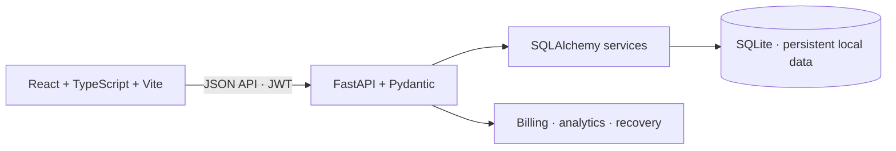

<div align="center">

# BRIGHTLOOP

### Subscription operations, in order.

**A connected workspace for recurring revenue — from the first plan to the next collected payment.**

[](https://github.com/aswine2005/Subscription-Management-System/actions/workflows/ci.yml)


**Local UI:** `http://localhost:3000` &nbsp; · &nbsp; **API docs:** `http://localhost:8000/docs` &nbsp; · &nbsp; [Five-minute demo](DEMO.md)

</div>

---

## Product overview

Brightloop is a subscription-management application for a business that sells software, add-ons, and product variants on daily, weekly, monthly, and annual plans. It connects product setup, customer quotations, recurring billing, payment recording, customer self-service, and revenue reporting to one SQLite-backed API.

The project addresses the operational gap between **invoices issued** and **cash collected**. It includes the usual subscription and billing workflows, plus a **Revenue Recovery Lab** for turning overdue balances into an explainable, capacity-aware follow-up plan.

## What makes the Recovery Lab useful

A dashboard can report that money is overdue. The Recovery Lab helps a small team decide where to spend its next hour.

- **Actual remaining balances:** invoices are grouped by customer and completed receipts are subtracted.
- **Revenue exposure:** see tax-exclusive monthly recurring revenue held by late-paying accounts, counting each active contract once.
- **Explainable priorities:** inspect how invoice age, relative balance, and missed promises contribute points.
- **Thoughtful collection holds:** disputed invoices, on-track promises, and recent contact attempts stay out of fresh follow-up targets.
- **Capacity-aware scenarios:** model a user-selected follow-up capacity and collection assumption, then save a reviewable snapshot.
- **Operational follow-through:** reconcile promises against later receipts, log staff notes, and prepare reminder drafts for review.

The score is an operational ordering rule. The collection rate is a user-supplied scenario assumption. Neither is presented as a payment probability. Saving a scenario does not create a receipt or send a message.

## Capabilities

| Area | Workflows |
| --- | --- |
| Products and plans | Catalog, variants and surcharges, billing cadence, availability, quantity minimums, lifecycle policies |
| Quotes and subscriptions | Reusable quote templates, validity windows, offers, contract lifecycle, plan-governed actions |
| Billing desk | Review upcoming runs, inspect skipped-row reasons, apply taxes and discounts, generate invoices with duplicate-period protection |
| Invoices and receipts | Confirm, cancel, print, record full or partial receipts, inspect remaining balances and payment references |
| Revenue overview | Active contracts, tax-exclusive MRR/ARR, actual receipts, open balances, overdue accounts, plan mix, recent activity |
| Recovery Lab | Evidence-backed queue, collection holds, what-if scenarios, saved plans, follow-up notes, promises, reminder drafts |
| Access control | Admin configuration, staff operations, customer registration, role-scoped customer portal |

**Currency:** Values use INR and Indian number grouping across the application. Seeded numeric prices are treated as rupees without exchange-rate conversion. The Odoo variant surcharge is ₹560. Receipts support paise precision.

## Application structure



The frontend reads live API data and refreshes operational summaries every 30 seconds. The default database is `backend/brightloop.db`. It is created and seeded on the first API start; later changes persist across restarts. SQLite has no separate server username or password. Application passwords are stored as bcrypt hashes.

The demo needs no cloud database, payment gateway, or AI API. Payment screens record receipts; they do not charge cards or move money. Without SMTP settings, generated email messages remain in the private `backend/outbox/` folder for local inspection.

## Run locally

**Prerequisites:** Python 3.10+ and Node.js 20+.

Start the API in Terminal 1:

```sh
cd backend
python3 -m venv venv
source venv/bin/activate                 # Windows PowerShell: venv\Scripts\Activate.ps1
pip install -r requirements.txt
python run.py
```

Start the web app in Terminal 2:

```sh
cd frontend
npm ci
npm run dev
```

Open [http://localhost:3000](http://localhost:3000). The REST API runs at [http://localhost:8000](http://localhost:8000), and interactive API documentation is at [http://localhost:8000/docs](http://localhost:8000/docs). Keep the API terminal running while using the UI.

On its first start, the API creates the database and seeds demo accounts and sample business data. Seeding runs only when the database is empty. To use another database file, set `DATABASE_URL`. To deliver real email, configure `SMTP_HOST`, `SMTP_PORT`, and `SMTP_FROM` (and SMTP authentication settings if required).

### Demo accounts

Use the email as the username. On a freshly seeded database, these accounts use the normal API login.

| Role | Email | Password | Main access |
| --- | --- | --- | --- |
| Admin | `admin@brightloop.dev` | `Admin@123` | Configuration, team, and all operations |
| Staff | `sarah.staff@brightloop.dev` | `Staff@123` | Billing, subscriptions, invoices, payments, Recovery Lab |
| Staff | `david.staff@brightloop.dev` | `Staff@123` | Day-to-day operations |
| Customer | `liam.vance@apexglobalsaas.com` | `Customer@123` | Liam’s own customer-portal records |

Other seeded customers use `Customer@123`. A database created earlier preserves its existing records; if a demo password was changed, use that password. Replacing the database creates a fresh demo dataset and discards its current records.

## Account registration

Yes, a user can create an account. Choose **Create account** on the sign-in page or open `/register`. Public registration creates a **customer** account. Passwords must be longer than eight characters and include an uppercase letter, a lowercase letter, and a special character. Only admins can provision staff, through **Team & customers**. Role permissions and customer data ownership are enforced by the API.

## Data storage

The default SQLite file is **`backend/brightloop.db`**. It stores users, subscriptions, invoices, payment records, saved recovery plans, and follow-up cases. The database file is ignored by Git. A generated `backend/.brightloop-secret` protects local sessions; local email output is under `backend/outbox/`. Those files are ignored too.

`DATABASE_URL` can point SQLAlchemy at another supported database. No database service or database password is needed for the default SQLite setup. Back up the database before replacing it; deleting the file causes the next API start to create a fresh seeded demo database.

## Find features in the website

Sign in and use the left navigation:

1. **Overview** — receipts, recurring revenue, open and overdue balances, upcoming billing.
2. **Recovery lab** — inspect priority evidence, adjust follow-up capacity and assumptions, save a scenario, or log an action.
3. **Billing desk** — rehearse an upcoming run, review ready and skipped contracts, then generate invoices.
4. **Subscriptions** — review or create contracts and manage their lifecycle.
5. **Invoices** and **Payments** — inspect invoice state, print documents, and record receipts.
6. **Quote templates** — create reusable customer offers.
7. **Products, Plans, Discounts, Taxes & rules, Team & customers** — admin configuration.

Customers see only their own subscriptions and invoices in the customer portal. Admin and staff can use the Recovery Lab; configuration screens are admin-only. See [DEMO.md](DEMO.md) for a judge walkthrough and requirement map, and [LOGIN.md](LOGIN.md) for a compact account reference.

## Validation and performance

Frontend tests and production build:

```sh
cd frontend
npm test
npm run build
```

Backend API tests and the isolated 1,000-contract benchmark:

```sh
cd backend
source venv/bin/activate
pip install -r requirements-dev.txt
python -m unittest discover -s tests -v
python -m tests.benchmark
```

The benchmark covers subscription and invoice reads, dashboard summaries, billing previews, recovery analysis, and recovery scenarios against a generated SQLite fixture. It does not modify the demo database. GitHub Actions runs the backend suite and frontend tests/build on pushes and pull requests.

## Repository map

```text
backend/app/                  API routes, schemas, models, and services
backend/tests/                Isolated API tests and benchmark
frontend/src/pages/           Dashboard, billing, recovery, customer and admin flows
frontend/src/api/             Typed API clients
frontend/public/              Static assets and animated workflow illustration
DEMO.md                       Walkthrough and requirement map
LOGIN.md                      Local demo account reference
```

## Operational boundaries

Brightloop is a working local hackathon application. It records payment receipts but does not process card transactions. Email messages remain local unless SMTP is configured. A production rollout would need deployment-specific backups and monitoring, payment-provider integration, and operational safeguards.
