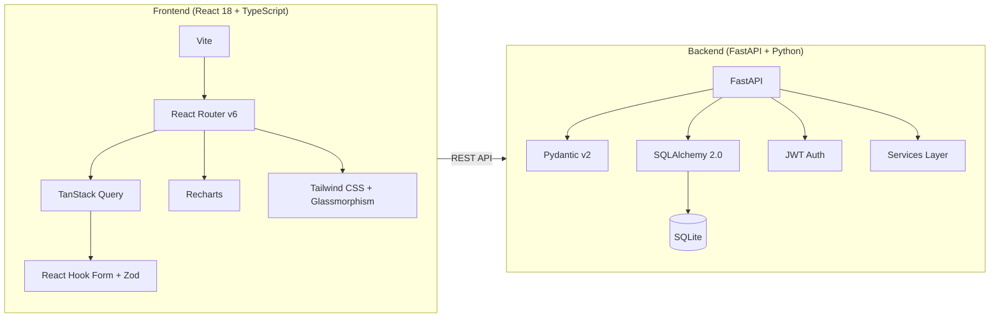
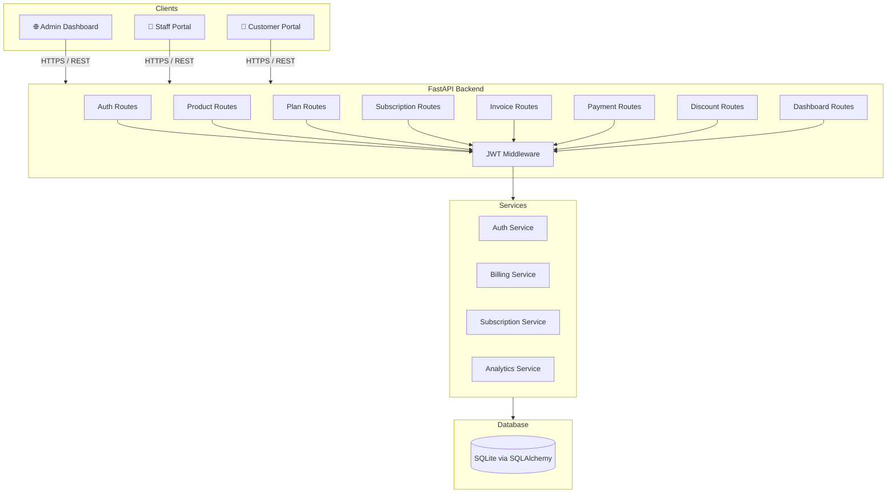
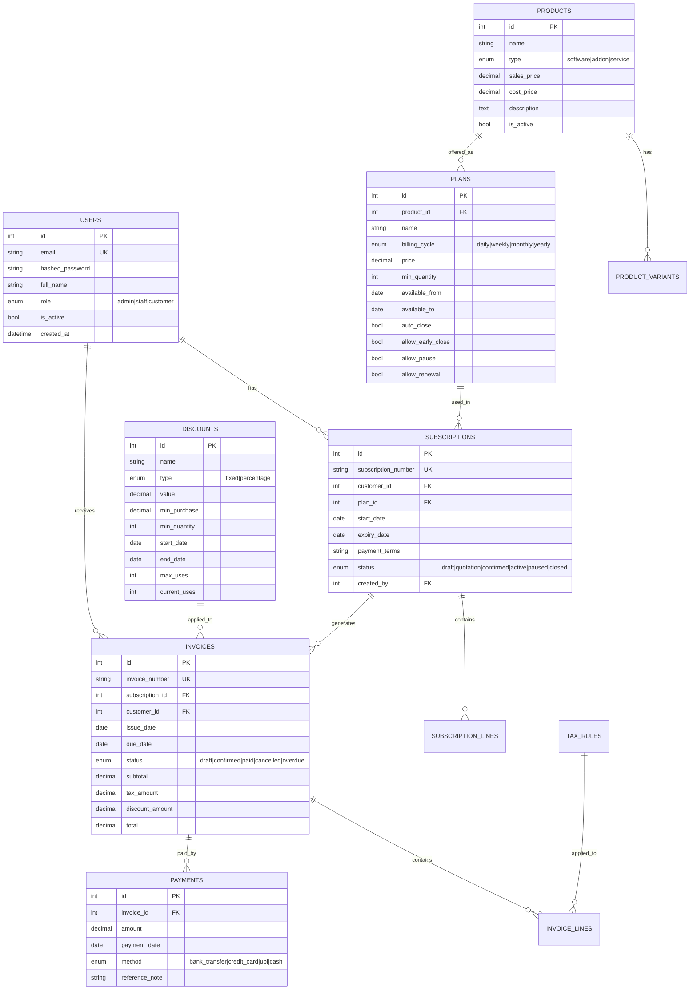

# 🚀 BrightLoop — Subscription Management System

## Architecture & Setup Guide

### What Makes BrightLoop Unique

| Feature | Typical Hackathon Projects | BrightLoop |
|---|---|---|
| **Data** | Static JSON files | Real SQLite DB with SQLAlchemy ORM + 250+ seeded records |
| **Auth** | Basic login | JWT + RBAC (Admin/Staff/Customer) with proper password policy |
| **UI** | Bootstrap templates | Custom glassmorphism design system with dark/light mode |
| **Analytics** | Basic counts | MRR, ARR, churn rate, revenue trends, customer segmentation |
| **Billing** | Manual | Automated bulk invoice generation with tax & discount auto-application |
| **Architecture** | Monolith | Clean separation: FastAPI → Services → Models → SQLAlchemy |
| **Validation** | Server-only | Dual: Zod (client) + Pydantic (server) with real-time feedback |

---

### Tech Stack



---

### Quick Start

#### 1. Backend
```bash
cd backend
python3 -m venv venv
source venv/bin/activate
pip install -r requirements.txt
python run.py
```
Backend runs at **http://localhost:8000**. API docs at **/docs**.

#### 2. Frontend
```bash
cd frontend
npm install
npm run dev
```
Frontend runs at **http://localhost:5173**

#### 3. Login Credentials
| Role | Email | Password |
|------|-------|----------|
| Admin | admin@brightloop.dev | Admin@123 |
| Staff | sarah@brightloop.dev | Staff@123 |
| Staff | mike@brightloop.dev | Staff@123 |
| Customer | (any seeded customer) | Customer@123 |

---

### System Architecture



---

### Database Schema



---

### Git Branching Strategy

For your team of 3-4 members:

```
main (production-ready)
  └── develop (integration)
       ├── feature/auth         (Member 1)
       ├── feature/billing      (Member 2)
       ├── feature/dashboard    (Member 3)
       └── feature/ui-polish    (Member 4)
```

**Rules:**
1. Never push directly to `main`
2. Create feature branches from `develop`
3. Do Pull Requests for code review
4. Merge to `develop` first, then `develop` → `main`

```bash
# Team setup commands
git checkout -b develop
git push -u origin develop

# Each member:
git checkout develop
git pull origin develop
git checkout -b feature/your-feature
# ... work ...
git add . && git commit -m "feat: description"
git push -u origin feature/your-feature
# Then create PR on GitHub
```

---

### API Endpoints Reference

| Method | Endpoint | Auth | Description |
|--------|----------|------|-------------|
| POST | `/api/v1/auth/register` | Public | Customer registration |
| POST | `/api/v1/auth/login` | Public | Login, returns JWT |
| POST | `/api/v1/auth/forgot-password` | Public | Password reset request |
| GET | `/api/v1/users` | Admin | List all users |
| POST | `/api/v1/users/staff` | Admin | Create staff user |
| GET/POST | `/api/v1/products` | Admin | Manage products |
| GET/POST | `/api/v1/plans` | Admin | Manage plans |
| GET/POST | `/api/v1/subscriptions` | Staff+ | Manage subscriptions |
| PATCH | `/api/v1/subscriptions/{id}/status` | Staff+ | Transition status |
| GET/POST | `/api/v1/invoices` | Staff+ | Manage invoices |
| POST | `/api/v1/invoices/generate-bulk` | Staff+ | Bulk billing |
| GET/POST | `/api/v1/payments` | Staff+ | Record payments |
| GET/POST | `/api/v1/discounts` | Admin | Manage discounts |
| GET | `/api/v1/dashboard/summary` | Staff+ | Analytics data |

---

> [!TIP]
> The seeded database contains 12 months of realistic data, making dashboard charts look impressive from the first demo.
