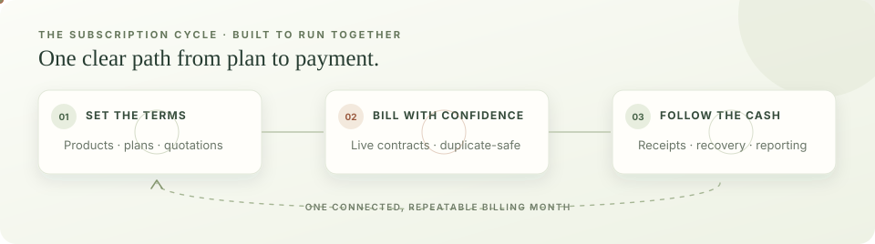

<div align="center">

# Brightloop

### Subscription operations, in order.

One workspace to set up plans, run recurring billing, reconcile receipts, and decide what needs attention next.



Local app: `http://localhost:3000` · API docs: `http://localhost:8000/docs` · [Demo walkthrough](DEMO.md)

</div>

---

## The problem we solve

Subscription businesses often manage renewals in spreadsheets, prepare invoices by hand, match receipts across bank statements, and assemble revenue reports at month end. Brightloop connects those steps to one persistent ledger, so the team can see what is active, what was billed, what was paid, and what still needs attention.

## The differentiator: Revenue Recovery Lab

The Recovery Lab turns overdue invoices into a practical, reviewable work queue. It groups debt by customer, uses completed receipts to calculate remaining balances, and connects those balances to the customer's active monthly recurring revenue. Staff can inspect the evidence behind each priority and test a plan against the team's follow-up capacity.

- **Explainable priorities:** invoice age, relative balance, and missed payment promises are shown as separate score components.
- **Useful collection holds:** disputes, on-track promises, and contacts made during the last two days stay out of fresh follow-up targets.
- **A real what-if tool:** choose the number of customers to target, the share of eligible balances to model, and a minimum invoice age.
- **A reliable follow-up record:** log notes, disputes, contacts, and dated payment promises. Promises are reconciled against completed receipts.
- **A plan the team can review:** save a timestamped snapshot of assumptions, target accounts, and modeled results.
- **A careful boundary:** scenarios never create payments; reminder emails are drafts for staff to review and send through their own channel.

The score sorts operational work. The collection percentage is an assumption selected by the user. Neither is presented as an AI prediction or a guarantee of payment.

## Subscription workflows

- Maintain products, variants, prices, plans, taxes, and discount rules.
- Create customer quotations from reusable templates and track them through the subscription lifecycle.
- Preview upcoming invoices, understand skipped billing rows, and generate invoices with duplicate-period protection.
- Confirm, cancel, print, and review invoices. Record full or partial receipts by date, method, and reference.
- View recurring revenue, actual receipts, balances, overdue accounts, plan mix, and recent activity.
- Give customers a role-scoped portal for their own subscriptions, quotations, and invoices.
- Run a billing desk rehearsal before generating a batch. Previewing does not create invoices or consume discounts.

The application uses rupees throughout (`INR`), including tax and discount calculations, invoice totals, receipts, charts, exports, and reminder drafts. Existing seeded numeric prices are treated as rupees; no exchange-rate conversion is applied. The Odoo brand variant surcharge is ₹560.

## How it is built

```text
React + TypeScript + Vite
          │  JSON API, JWT sessions
          ▼
FastAPI + Pydantic
          │  SQLAlchemy
          ▼
SQLite database on this machine
```

The UI reads live data from the API and refreshes operational summaries every 30 seconds. SQLite persists subscriptions, invoices, payments, saved recovery plans, and collection actions in `backend/brightloop.db`. The local demo does not require a hosted database or an AI API. When SMTP is not configured, generated email is saved in the private local `backend/outbox/` folder.

## Run locally

Requirements: Python 3.10 or newer and Node.js 20 or newer.

Terminal 1 — API:

```sh
cd backend
python3 -m venv venv
source venv/bin/activate        # Windows PowerShell: venv\Scripts\Activate.ps1
pip install -r requirements.txt
python run.py
```

Terminal 2 — web app:

```sh
cd frontend
npm ci
npm run dev
```

Open [http://localhost:3000](http://localhost:3000). The API docs are at [http://localhost:8000/docs](http://localhost:8000/docs). The database is created and seeded at first start; later changes persist between restarts.

### Local demo sign-ins

| Role | Email | Password |
| --- | --- | --- |
| Admin | `admin@brightloop.dev` | `Admin@123` |
| Staff | `sarah.staff@brightloop.dev` | `Staff@123` |
| Staff | `david.staff@brightloop.dev` | `Staff@123` |
| Customer | `liam.vance@apexglobalsaas.com` | `Customer@123` |

These are local seeded demo credentials. Other seeded customers use `Customer@123`; newly registered users choose their own password. SQLite itself has no database username or password. Application accounts are authenticated by the API, with passwords stored as hashes.

## Try the Recovery Lab

1. Sign in as Admin or Staff and open **Recovery lab**.
2. Open an account to inspect its invoices and priority evidence.
3. Adjust the follow-up capacity and collection assumption. The result is a scenario based on current eligible invoice balances.
4. Save a plan and reopen it to review its historical snapshot.
5. Try a follow-up note or prepare a reminder draft. These actions do not contact a customer.

For a full billing demonstration, including creating a quotation, generating an invoice, and recording partial receipts, see [DEMO.md](DEMO.md).

## Validation and performance

Run the frontend checks:

```sh
cd frontend
npm test
npm run build
```

Run the isolated API tests and the reproducible 1,000-contract benchmark:

```sh
cd backend
source venv/bin/activate
pip install -r requirements-dev.txt
python -m unittest discover -s tests -v
python -m tests.benchmark
```

The benchmark exercises subscription and invoice reads, dashboard summaries, billing previews, and recovery analysis/simulation against a generated SQLite fixture. It does not modify the seeded demo database.

## Project layout

```text
backend/app/       API routes, schemas, models, and services
backend/tests/     Isolated API tests and benchmark
frontend/src/       React pages, API clients, and shared UI
frontend/public/    Static assets, including the animated workflow illustration
DEMO.md             Judge walkthrough and requirement map
LOGIN.md            Local demo access notes
```

## Scope

Brightloop records receipts; it does not charge cards or move money. Real email delivery requires SMTP configuration. The current project is designed as a local hackathon demo; a production deployment would add payment-provider webhooks, managed backups, rate limits, and operational monitoring.
